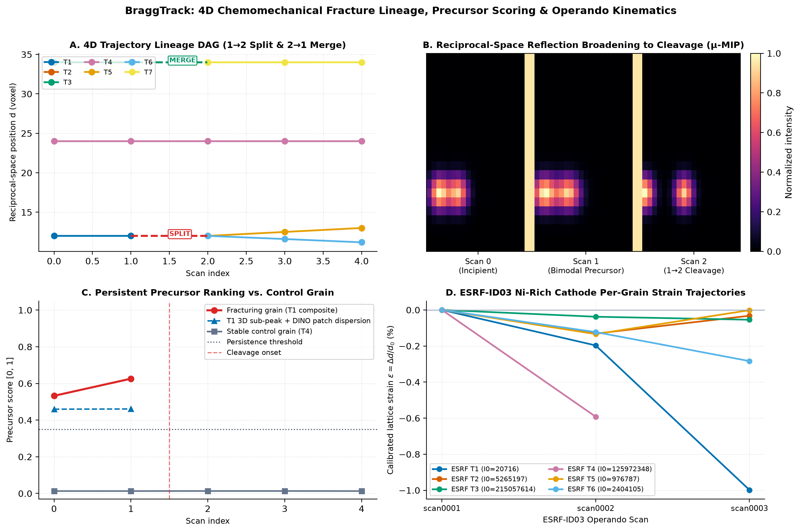
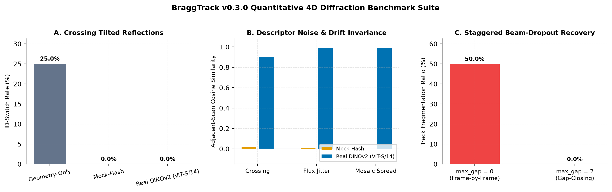

# BraggTrack

[](https://colab.research.google.com/github/BASE-Laboratory/BraggTrack/blob/main/notebooks/braggtrack_demo.ipynb)

4D Bragg reflection tracking, crystallographic grain kinematics, multi-scan beam-dropout gap closing, and split/merge lineage (`1 -> 2+` fracture splits & `2+ -> 1` coalescence merges) for operando X-ray diffraction.

<p align="center">
  
</p>

## Key Capabilities

- **Beamline-scale NeXus/HDF5 I/O, `darfix`/BLISS auto-calibration & operando sync (`braggtrack.io`)** — Auto-discovers 3D detector cubes across `darfix` `NXdata` (`@default` / `@signal` / `@axes`), ESRF-ID03 LIMA files (`/entry_0000/ESRF-ID03/pco_nf/data`), ESRF BLISS `instrument/positioners`, and arbitrary HDF5 trees (`auto_discover=True`). Streams `z`-slabs via `LazyVolume`, synchronizes external potentiostat / load-frame logs (`CSV`/`TSV` and Biologic EC-Lab `.mpt`, regularized $\mathrm{d}Q/\mathrm{d}V$, $\partial\varepsilon/\partial V$), maps transmission geometry `(2theta, eta, d, |Q|)` via `DetectorGeometry`, and exports directly to **`ImageD11` (`.flt`)** and **NeXus `NXprocess` HDF5 (`.nxs`)**.
- **Pedestal-safe 3D Bragg reflection segmentation (`braggtrack.segmentation`)** — Read-noise-guarded chunked Otsu foreground masking (`detector_foreground_threshold`) with cross-scan rolling-median smoothing (`smooth_thresholds`), 3D LoG peak enhancement, robust `h`-maxima seeding, 3D watershed, nearby-basin merging, analytical Poisson + quantization centroid uncertainties (`centroid_*_err`), and physical or voxel-space covariance/eigenvalue extraction. Includes an experimental dense patch-feature + HDBSCAN slice-stitching segmenter (`--method dino`).
- **4D grain kinematics, crowded-layer drift registration, optimal transport & precursors (`braggtrack.tracking`)** — Step-normalized 3D reciprocal-space `PositionShapeCost` or closed-form 3D Gaussian `WassersteinBuresCost` (`--cost-model wasserstein_bures`), collective rocking-slab 2D FFT phase-correlation + 6D constant-velocity Kalman drift compensation (`--drift-mode`), Jaqaman birth/death LAP association with runner-up `assignment_margin`, multi-scan gap closing (`--max-gap`), local strain ($\Delta d / d_0$), ancestor-referenced `lineage_strain` across splits, propagated $\sigma_\varepsilon$, causal angular/lattice velocities (`rate_mu`, `rate_chi`, `rate_d`, `strain_rate`), `cKDTree`-indexed log-intensity-conserved `1 -> 2+` split / `2+ -> 1` merge / `reversible_overlap` DAG edges, and baseline-referenced multi-scan fracture precursor ranking (`--precursor-baseline-reference`).
- **Optional multi-view morphological ViT descriptors (`braggtrack.semantic`)** — Opt-in (`--cost-beta > 0`) orthogonal $(\mu, \chi, d)$ maximum-intensity projections (MIPs) encoded in batched forward passes (`embed_batch`, `extract_patch_features_batch`) with revision-pinned ungated **`facebook/dinov2-small`**, drop-in **DINOv3** support, or a deterministic offline `mock` backend for ablation studies.
- **Online causal streaming, state-space `GP(Q, V)` & autonomous DFXM "Scout-and-Zoom" (`braggtrack.autonomous`, `braggtrack-watch`)** — Strictly causal trailing-window streaming tracker (`CausalStreamingTracker`) with $O(1)$-volume-RAM cached ROI precursors, wall-clock `GP(t)` or electrochemical state-space `GP(Q, V)` (`--forecast-domain state_space`) diffractometer setpoint forecasting during rapid phase transitions (e.g., Ni92 `H2 -> H3` collapse), `bliss_dfxm_zoom.v1` JSONL trigger emission (`zoom_triggers.jsonl`), and `O(1)`-RAM multi-hundred-scan archive evaluation (`braggtrack-eval-archive`).
- **Publication figures, operando $\mathrm{d}Q/\mathrm{d}V$ dashboards & offline HTML 4D Explorer (`braggtrack.viz`, `braggtrack-report`)** — Generates Okabe–Ito styled lineage DAGs, strain/misorientation dashboards, 3-panel operando electrochemistry + fracture synchronization plots, precursor heatmaps, 3-view MIP cards, and a single-file interactive `report.html` that opens offline on air-gapped beamline networks.
- **One-command reproducible pipeline (`braggtrack-run`)** — Runs validation, operando stimulus sync, segmentation, classical 4D tracking (plus optional `--cost-beta > 0` embedding), kinematics, fracture event analysis, HTML reporting, and `ImageD11`/NeXus export end-to-end, emitting SHA-256 input checksums, stage timings, and `run_manifest.json`.

<p align="center">
  
</p>

---

## Installation

```bash
# Install directly from GitHub
pip install "git+https://github.com/BASE-Laboratory/BraggTrack.git"

# Or clone locally for editable installation:
# Core package (numpy, scipy, scikit-image, scikit-learn, networkx, h5py)
pip install -e .

# Core + test runner (pytest, pytest-cov; matplotlib plots auto-skip without [notebook])
pip install -e ".[test]"

# With PyTorch + HuggingFace Transformers for real DINOv2 / DINOv3 backbones
pip install -e ".[torch]"

# With Jupyter, Matplotlib, and Pandas for interactive notebooks & static figures
pip install -e ".[notebook]"

# Full developer environment (torch + notebook + test + ruff)
pip install -e ".[dev]"
```

---

## Quick Start

BraggTrack ships with three real ESRF ID03 operando Ni-rich cathode scans under [`data/sample_operando/`](data/sample_operando/README.md) (`100 x 250 x 250` `uint16` cubes). Omit the dataset path to run on the bundled scans automatically, or pass your own directory of `scanXXXX/` folders:

### One-command end-to-end pipeline (with interactive HTML report & NeXus/`ImageD11` exports)

```bash
braggtrack-run --outdir artifacts/pipeline \
  --cost-model wasserstein_bures \
  --drift-mode fft_kalman \
  --max-gap 1 \
  --report \
  --export-nexus artifacts/pipeline/results.nxs \
  --export-imaged11 artifacts/pipeline/peaks.flt
```

Produces:
- `artifacts/pipeline/validation_summary.json`
- `artifacts/pipeline/segmentation/` (`features.csv`, `labels.npz`, `summary.json`, QC notebook)
- `artifacts/pipeline/embedding/` (`embeddings.npz`, `embedding_manifest.json` when `--cost-beta > 0`)
- `artifacts/pipeline/tracking/` (`tracks.csv`, `kinematics.csv`, `kinematics_summary.json`, `tracking_summary.json`, QC notebook)
- `artifacts/pipeline/events/` (`events.csv`, `events.json`, `precursors.csv`, `events_summary.json`)
- `artifacts/pipeline/report/` (`report.html` interactive 4D Explorer + `figures/*.png`)
- `artifacts/pipeline/results.nxs` & `artifacts/pipeline/peaks.flt`
- `artifacts/pipeline/run_manifest.json` (SHA-256 input checksums, git SHA, config, stage timings)

### Stage-by-stage CLI commands (11 Entry Points)

| CLI Entry Point | Module Equivalent | Purpose |
|---|---|---|
| `braggtrack-inspect` | `python -m braggtrack.cli.inspect_datasets` | Discover `scan*` folders, primary 3D HDF5 dataset paths, and metadata |
| `braggtrack-validate` | `python -m braggtrack.cli.validate_dataset` | Validate sequence ordering, monotonic timestamps, and axis contracts |
| `braggtrack-segment-synthetic` | `python -m braggtrack.cli.segment_synthetic` | Run fast synthetic 3D segmentation smoke test |
| `braggtrack-segment-dataset` | `python -m braggtrack.cli.segment_dataset` | Segment 3D Bragg spots via pedestal-guarded chunked Otsu + smoothed thresholds |
| `braggtrack-embed-dataset` | `python -m braggtrack.cli.embed_dataset` | Stream lazy 3D spot ROIs & compute batched MIP embeddings (`auto`, `mock`, `torch`) |
| `braggtrack-track-dataset` | `python -m braggtrack.cli.track_dataset` | Build trajectory DAG (`--drift-mode`, `--cost-model`, `--max-gap`), export `.csv`, `.flt`, `.nxs` |
| `braggtrack-events` | `python -m braggtrack.cli.detect_events` | Resolve `1 -> 2+` splits, `2+ -> 1` merges, `reversible_overlap`, and fracture precursors |
| `braggtrack-report` | `python -m braggtrack.cli.report_dataset` | Render publication PNG/PDF figures (`--operando-log`) and self-contained `report.html` |
| `braggtrack-watch` | `python -m braggtrack.cli.watch_autonomous` | Live causal streaming watcher (`--mode watch`) & autonomous DFXM replay (`--forecast-domain`) |
| `braggtrack-eval-archive` | `python -m braggtrack.cli.eval_archive` | `O(1)`-RAM `1,000+`-scan archive evaluator (tracking ablations, `GP(Q,V)` horizons, precursor ROC/PR) |
| `braggtrack-run` | `python -m braggtrack.cli.run_pipeline` | Execute the full pipeline with optional `--config`, `--operando-log`, `--report`, and exports |

---

## Physical Axis Calibration (`mu`, `chi`, `d`) & Crystallographic Geometry (`2theta`, `eta`, `|Q|`)

Cropped detector cubes store integer voxel indices `[0..N)`. For physically meaningful lattice strain $\varepsilon = (d(t) - d_0) / d_0$ and angular misorientation in degrees, supply an `AxisCalibration` JSON file when segmenting:

```json
{
  "mu_origin": 12.50,
  "mu_step": 0.02,
  "chi_origin": -3.20,
  "chi_step": 0.015,
  "d_origin": 2.042,
  "d_step": -0.00012
}
```

For transmission 3DXRD / `ImageD11` indexing workflows, supply a `DetectorGeometry` JSON file (`--detector-json`) to annotate `omega_deg`, `two_theta_deg`, `eta_deg`, `d_spacing_angstrom`, and `(qx, qy, qz, q_mag_inv_angstrom)` and export `.flt` columnfiles:

```json
{
  "distance_mm": 150.0,
  "pixel_size_y_mm": 0.075,
  "pixel_size_x_mm": 0.075,
  "beam_center_y_px": 1024.0,
  "beam_center_x_px": 1024.0,
  "wavelength_angstrom": 0.2898,
  "omega_origin_deg": 0.0,
  "omega_step_deg": 0.05
}
```

---

## Vision Backbone Options & Quantitative Benchmarks

- **Default (`facebook/dinov2-small`)**: Public and ungated on HuggingFace — works out of the box with `pip install -e ".[torch]"` without tokens or license gates.
- **DINOv3 (`facebook/dinov3-vitb16-pretrain-lvd1689m`)**: Supported via `--model` / `--dino-model` after accepting Meta's license on HuggingFace and setting `HF_TOKEN`.
- **Offline / CI (`mock`)**: Deterministic SHA-256 multi-view projection encoder requiring zero GPU or network access (`--backend mock` or `BRAGGTRACK_DINO_BACKEND=mock`).

See [`docs/benchmarks.md`](docs/benchmarks.md) for the full 5-scenario benchmark evaluation (`scripts/benchmark_suite.py`) comparing **Geometry-Only**, **Mock-Hash**, and **Real `facebook/dinov2-small`** alongside the ESRF-ID03 case study.

---

## Notebooks

- [`notebooks/braggtrack_demo.ipynb`](notebooks/braggtrack_demo.ipynb) — End-to-end tutorial on the bundled ESRF-ID03 scans: discovery, lazy/chunked segmentation, physics & semantic tracking, multi-scan gap closing, per-grain kinematics, `braggtrack.viz` lineage & precursor plots, and crystallographic geometry mapping.
- [`notebooks/dino_segmentation_comparison.ipynb`](notebooks/dino_segmentation_comparison.ipynb) — Side-by-side comparison of stabilised classical 3D watershed vs. experimental DINO patch-clustering segmentation.

---

## Testing, Acceptance Gates & Pre-PR Checks

```bash
# Lint & format check
ruff check braggtrack/ tests/ scripts/
ruff format --check braggtrack/ tests/ scripts/

# Unit test suite with coverage
pytest tests/ -v --cov=braggtrack

# Full CI gate runner (unit tests + all 9 acceptance gates)
python scripts/ci_report.py

# Quantitative 5-scenario benchmark suite (add --include-torch for real DINOv2)
python scripts/benchmark_suite.py --trials 5

# Pre-PR hygiene check
python scripts/pre_pr_check.py
```

---

## Troubleshooting & FAQ

- **`MissingH5DependencyError` or custom HDF5 dataset paths:** `h5py` is installed by default with `pip install -e .`. `load_primary_volume()` and `LazyVolume` automatically inspect standard NeXus paths, `/entry_0000/ESRF-ID03/pco_nf/data`, and fall back to the largest 3D numeric dataset in the file. Pass `--allow-synthetic-fallback` only when testing schema plumbing on empty/metadata-only HDF5 stubs.
- **`401 Unauthorized` / gated HuggingFace model error:** You passed a gated model ID (such as `facebook/dinov3-*`) without authenticating. Either omit `--model` to use the ungated default (`facebook/dinov2-small`), or accept the model license on HuggingFace and export `HF_TOKEN`.
- **Unphysical strain percentages in `kinematics.csv`:** Check `"calibrated_axes"` in `kinematics_summary.json`. When `false`, `centroid_d` is measured in cropped detector pixels (`y` index) rather than Angstroms — pass `--calibration-json` (or `--detector-json`) to compute physical crystallographic quantities.

## Repository Layout & Contributing

- **`braggtrack/`** — Installable Python library (`io`, `segmentation`, `semantic`, `tracking`, `autonomous`, `viz`, `cli`).
- **`data/sample_operando/`** — Bundled ESRF-ID03 operando test scans (`scan0001`–`scan0003`).
- **`docs/`** — [Ecosystem Positioning & Autonomous DFXM Guide](docs/positioning.md), [Architecture](docs/architecture.md), [Benchmarks](docs/benchmarks.md), [Coding Practices](docs/coding-practices.md), and publication figures (`docs/figures/`).
- **`scripts/`** — 9 acceptance gates, 5-scenario benchmark suite (`benchmark_suite.py`), semantic α/β ablation (`ablation_semantic.py`), and CI runner (`ci_report.py`).
- **`artifacts/`** — Generated pipeline outputs (gitignored; never commit).

See [CONTRIBUTING.md](CONTRIBUTING.md) for contribution guidelines and [paper.md](paper.md) for the manuscript overview.

**Maintainer:** James Le Houx (`j.lehoux@greenwich.ac.uk`).
