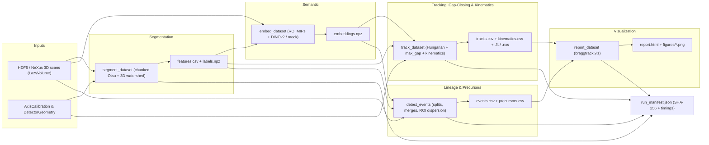

# BraggTrack architecture

This document describes how the repository is structured, how data flows through the pipeline, and where to extend functionality.

## Repository layout

```text
BraggTrack/
├── braggtrack/           # Installable Python package (v0.3.0)
│   ├── io/               # Discovery, LazyVolume streaming, AxisCalibration, DetectorGeometry, ImageD11 & NeXus export
│   ├── segmentation/     # Classical 3D LoG+watershed, chunked Otsu + threshold smoothing, experimental DINO segmenter
│   ├── semantic/         # Orthogonal (mu, chi, d) MIPs + frozen ViT / patch encoders (DINOv2 default, DINOv3, mock)
│   ├── tracking/         # Costs, Hungarian assignment, multi-scan gap closing, kinematics, split/merge DAG, precursors
│   ├── viz/              # Publication plots (MIPs, Lineage DAG, Strain fans, Precursors) + interactive HTML 4D Explorer
│   └── cli/              # Thin argparse entry points (9 CLIs) + reproducible run_pipeline orchestrator
├── data/
│   └── sample_operando/  # Bundled ESRF-ID03 Ni-rich cathode operando scans (scan0001..scan0003)
├── notebooks/            # End-to-end demo and DINO vs. classical segmentation notebooks
├── docs/                 # Architecture, quantitative benchmarks, figures, and coding practices
├── scripts/              # 9 acceptance gates, 5-scenario benchmark suite, semantic ablation, ci_report.py
├── tests/                # Unit and acceptance test suite
└── artifacts/            # Generated outputs (gitignored)
```

## Layered design

| Layer | Responsibility | Key Types / Functions | Depends on |
|---|---|---|---|
| **io** | Discover scans, stream `LazyVolume` HDF5 slices & chunked Otsu histograms, calibrate `(mu, chi, d)` & `(2theta, eta, d, \|Q\|)`, export `ImageD11` `.flt` & NeXus `.nxs` | `LazyVolume`, `otsu_threshold_chunked`, `AxisCalibration`, `DetectorGeometry`, `export_imaged11_flt`, `export_nexus_process` | `numpy`, `h5py` |
| **segmentation** | Multi-scan threshold smoothing, 3D LoG + `h`-maxima + watershed (or experimental DINO + HDBSCAN), physical/voxel feature table | `segment_classical`, `smooth_thresholds`, `segment_dino`, `extract_instance_table` | `numpy`, `scipy`, `scikit-image`, `scikit-learn` |
| **semantic** | Lazy ROI spot cropping, orthogonal MIPs, multi-view global embeddings & dense patch-token grids | `crop_spot_cube`, `orthogonal_mips`, `make_multiview_encoder`, `make_patch_encoder` | `numpy`, optional `torch` + `transformers` |
| **tracking** | Vectorised geometry + semantic cost, Hungarian assignment, multi-scan gap closing (`max_gap`), per-grain kinematics, `1 -> 2+` split & `2+ -> 1` merge lineage, fracture precursors | `PositionShapeCost`, `GeometrySemanticCost`, `resolve_track_gaps`, `build_tracks`, `compute_grain_kinematics`, `resolve_splits_and_merges`, `compute_fracture_precursors` | `numpy`, `scipy`, `networkx` |
| **viz** | Publication figures and zero-CDN offline interactive HTML 4D Lineage & Strain Explorer | `plot_lineage_dag`, `plot_kinematics_dashboard`, `plot_precursor_timeline`, `plot_spot_mip_card`, `generate_html_report` | `numpy`, optional `matplotlib` (HTML explorer uses stdlib only) |
| **cli** | Parse args/JSON config, orchestrate stages, write CSV/JSON/NPZ/FLT/NXS/HTML artifacts and SHA-256 `run_manifest.json` | `segment_dataset`, `embed_dataset`, `track_dataset`, `detect_events`, `report_dataset`, `run_pipeline` | All of the above |

**Rule of thumb:** keep **numeric kernels** and **typed data contracts** in subpackages; keep **CLI modules** as thin orchestration layers.

## Data flow (`braggtrack-run`)



- **Dataset root** is a directory containing `scan*` folders (defaults to bundled `data/sample_operando/` when present).
- **Physical coordinates vs. voxel indices:** `extract_instance_table(..., calibration=cal)` converts `centroid_mu`, `centroid_chi`, `centroid_d`, `cov_*`, and `eig_1..3` into physical reciprocal-space units while preserving integer voxel `bbox_*` indices so downstream 3D ROI cropping (`crop_spot_cube` over `LazyVolume`) remains exact.
- **Artifacts** under `artifacts/` are reproducible build outputs and are never committed to Git.

## Extension points

1. **New beamline / HDF5 layout** — add candidate paths to `PRIMARY_VOLUME_CANDIDATES` in `braggtrack/io/nexus.py` (or rely on the built-in largest-3D numeric dataset discovery) and extend `extract_axis_calibration` if custom motor metadata groups are used.
2. **New segmentation method** — implement alongside `segment_classical` / `segment_dino` returning `ClassicalSegmentationResult`, then feed `(labels, volume, calibration=...)` to `extract_instance_table`.
3. **New association cost** — implement `pairwise_cost_matrix` + scalar `__call__` matching `CostFunction` in `braggtrack/tracking/cost.py`.
4. **Custom precursor signals** — extend `compute_fracture_precursors` in `braggtrack/tracking/precursors.py` to incorporate additional morphological or diffraction rocking-curve descriptors while retaining contiguous `min_persistence` filtering.

## Performance notes

- `LazyVolume` streams `z`-slabs (`otsu_threshold_chunked`) in Pass 1 of `segment_dataset` and reads only tight 3D spot ROIs (`read_roi`) in `embed_dataset` and `detect_events`, avoiding full-volume `float64` allocations on multi-gigabyte detector stacks.
- Frame-to-frame Hungarian association and multi-scan gap closing (`resolve_track_gaps`) build cost matrices via vectorised `scipy.spatial.distance.cdist` and dense matrix multiplication (`A @ B.T`) for semantic cosine similarity.

## Configuration surfaces

- **Environment variables:**
  - `BRAGGTRACK_DATA_ROOT`: Override default dataset root discovery.
  - `BRAGGTRACK_DINO_BACKEND`: Force `auto`, `mock`, or `torch` backend selection.
- **Pipeline JSON config:** Pass `--config pipeline.json` to `braggtrack-run` to declaratively configure backend, model ID (`DEFAULT_DINO_MODEL = "facebook/dinov2-small"` or DINOv3), calibration/detector JSON files, `max_gap`, semantic weights (`cost_alpha`, `cost_beta`), split/precursor thresholds, `--report`, and `ImageD11` / NeXus export paths.
