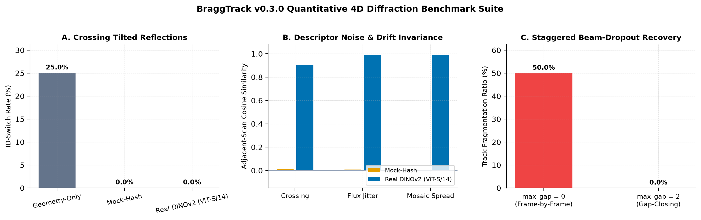
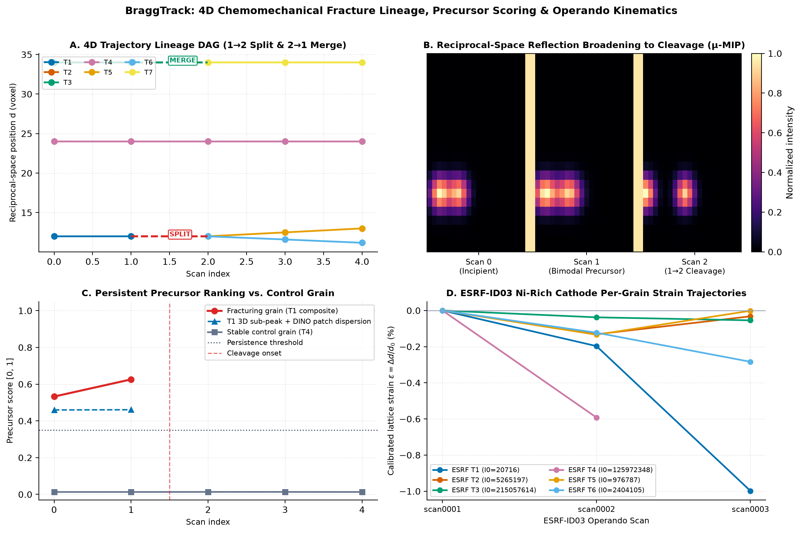

# BraggTrack v0.4.0 Benchmarks, ESRF-ID03 Case Study & Autonomous DFXM Replay

This document reports reproducible multi-trial quantitative benchmarks for **BraggTrack v0.4.0**, comparing **Geometry-Only**, **Deterministic Mock-Hash** (`mock`), and **Pretrained Vision Transformer** (`torch` with ungated `facebook/dinov2-small`) tracking, gap-closing, and 4D chemomechanical fracture precursor scoring, followed by an end-to-end case study on bundled operando dark-field X-ray microscopy (DFXM) data from **ESRF ID03** and a closed-loop **Autonomous "Scout-and-Zoom" Causal Replay Benchmark**.

All synthetic benchmarks can be reproduced via:

```bash
python scripts/benchmark_suite.py \
    --include-torch \
    --model facebook/dinov2-small \
    --trials 5 \
    --bootstrap-samples 500 \
    --output-json artifacts/benchmarks/benchmark_results.json \
    --output-figure docs/figures/benchmark_comparison.png
```



---

## 1. Benchmark Methodology

To isolate when pretrained multi-view morphological features genuinely outperform classical 3D centroid + covariance tracking—and to verify that gains come from learned visual structure rather than arbitrary feature dimensionality—`scripts/benchmark_suite.py` evaluates three backends under identical segmentation and Hungarian/Jaqaman solver configurations:

1. **`geo` (Geometry-Only, $\alpha=1.0, \beta=0.0$):** Uses calibrated 3D reciprocal-space centroid displacement and log-eigenvalue shape distance (`Eigen-Shape`), with zero semantic weight.
2. **`mock` (Deterministic Hash Baseline, $\alpha=1.0, \beta=0.6$):** Appends `1152`-d `SHA-256` multi-view MIP vectors (`MockDinoEncoder`). Useful solely for deterministic offline CI plumbing; slight pixel changes completely decorrelate consecutive scan hashes.
3. **`torch` (Pretrained `facebook/dinov2-small`, $\alpha=1.0, \beta=0.6$):** Extracts `1152`-d L2-normalized multi-view orthogonal MIP embeddings (`3` projections $\times$ `384`-d ViT-S/14 features) and `16x16` spatial patch tokens for sub-spot precursor dispersion.

### Scenarios Evaluated (`N = 5` trials, `500` bootstrap resamples for 95% CIs)

| Scenario | Physical Beamline Regime | Primary Failure Mode Tested |
| :--- | :--- | :--- |
| **`crossing_morphology`** | Two sub-grains on an antipodal circle ($R = 4.2\text{ px}$) rotating $90.25^\circ$ between scans with orthogonal $+45^\circ$ vs $-45^\circ$ streak tilt (`3D` eigenvalues identical by symmetry) | Equidistant / near-degenerate 3D geometry causing catastrophic Hungarian ID swaps without 2D MIP orientation semantics |
| **`intensity_jitter`** | $\pm 45\%$ incident synchrotron beam-flux spikes + Poisson/Gaussian detector shot noise across 6 scans | Photometric invariance of L2-normalized ViT MIP embeddings vs pixel-hash fragility |
| **`mosaic_broadening`** | Progressive rocking-curve ($\mu$) mosaic broadening ($1.0\times \to 1.9\times$) under electrochemical cycling | Smooth morphological continuity ($\cos > 0.98$) as Bragg reflections broaden |
| **`beam_dropout_no_gap` vs `beam_dropout_gap2`** | Staggered 1-scan rocking-window dropouts across 4 grains over 6 scans (`max_gap=0` vs `max_gap=2`) | Track fragmentation and cross-grain jump hijacking vs Jaqaman diffusive gap-closing recovery |
| **`chemomechanical_fracture`** | 8-scan 4D grain evolution with persistent pre-split broadening + sub-peak bimodality (`scans 1-3`), `1 -> 2` split (`scan 3 -> 4`), `2 -> 1` merge (`scan 5 -> 6`), and isotropic control | Exact split/merge lineage recall and pre-fracture precursor score contrast against stable control grains |

---

## 2. Quantitative Multi-Trial Results (`facebook/dinov2-small`)

### 2.1 Tracking Identity, Gap-Closing & Embedding Stability

| Scenario | Backend | Mean ID-Switch Rate (95% CI) | Fragmentation Ratio (95% CI) | Gap Closures | Cosine Stability $\cos(\mathbf{z}_t, \mathbf{z}_{t+1})$ | Elapsed (`5` trials, CPU) |
| :--- | :--- | :---: | :---: | :---: | :---: | :---: |
| **`crossing_morphology`** | `geo` | `0.2500` (`[0.2500, 0.2500]`) | `0.0000` (`[0.0000, 0.0000]`) | `0.0` | — | `0.51 s` |
| **`crossing_morphology`** | `mock` | `0.0000` (`[0.0000, 0.0000]`) | `0.0000` (`[0.0000, 0.0000]`) | `0.0` | `0.0160` | `0.50 s` |
| **`crossing_morphology`** | **`torch` (`dinov2-small`)** | **`0.0000` (`[0.0000, 0.0000]`)** | **`0.0000` (`[0.0000, 0.0000]`)** | `0.0` | **`0.9035`** | `43.80 s` |
| **`intensity_jitter`** | `geo` | `0.0000` (`[0.0000, 0.0000]`) | `0.0000` (`[0.0000, 0.0000]`) | `0.0` | — | `0.04 s` |
| **`intensity_jitter`** | `mock` | `0.0000` (`[0.0000, 0.0000]`) | `0.0000` (`[0.0000, 0.0000]`) | `0.0` | `0.0089` | `0.05 s` |
| **`intensity_jitter`** | **`torch` (`dinov2-small`)** | **`0.0000` (`[0.0000, 0.0000]`)** | **`0.0000` (`[0.0000, 0.0000]`)** | `0.0` | **`0.9908`** | `10.66 s` |
| **`mosaic_broadening`** | `geo` | `0.0000` (`[0.0000, 0.0000]`) | `0.0000` (`[0.0000, 0.0000]`) | `0.0` | — | `0.05 s` |
| **`mosaic_broadening`** | `mock` | `0.0000` (`[0.0000, 0.0000]`) | `0.0000` (`[0.0000, 0.0000]`) | `0.0` | `-0.0031` | `0.05 s` |
| **`mosaic_broadening`** | **`torch` (`dinov2-small`)** | **`0.0000` (`[0.0000, 0.0000]`)** | **`0.0000` (`[0.0000, 0.0000]`)** | `0.0` | **`0.9899`** | `10.85 s` |
| **`beam_dropout_no_gap` (`max_gap=0`)** | `geo` / `mock` / `torch` | `0.0833` (`[0.0833, 0.0833]`) | `0.5000` (`[0.5000, 0.5000]`) | `0.0` | `— / 0.0048 / 0.9879` | `0.07–17.83 s` |
| **`beam_dropout_gap2` (`max_gap=2`)** | `geo` | `0.0000` (`[0.0000, 0.0000]`) | `0.0000` (`[0.0000, 0.0000]`) | **`2.0`** | — | `0.07 s` |
| **`beam_dropout_gap2` (`max_gap=2`)** | `mock` | `0.0833` (`[0.0833, 0.0833]`) | `0.5000` (`[0.5000, 0.5000]`) | `0.0` | `0.0048` | `0.08 s` |
| **`beam_dropout_gap2` (`max_gap=2`)** | **`torch` (`dinov2-small`)** | **`0.0000` (`[0.0000, 0.0000]`)** | **`0.0000` (`[0.0000, 0.0000]`)** | **`2.0`** | **`0.9879`** | `17.88 s` |

### 2.2 4D Chemomechanical Fracture & Precursor Benchmark

| Scenario | Backend | `1 -> 2` Split Recall | `2 -> 1` Merge Recall | Top-1 Precursor Precision | Precursor Contrast $\Delta S$ vs Control (95% CI) | Elapsed (`5` trials, CPU) |
| :--- | :--- | :---: | :---: | :---: | :---: | :---: |
| **`chemomechanical_fracture`** | `geo` | `1.00` | `1.00` | `1.00` | `0.6449` (`[0.6448, 0.6450]`) | `0.13 s` |
| **`chemomechanical_fracture`** | `mock` | `1.00` | `1.00` | `1.00` | `0.5539` (`[0.5538, 0.5540]`) | `0.29 s` |
| **`chemomechanical_fracture`** | **`torch` (`dinov2-small`)** | **`1.00`** | **`1.00`** | **`1.00`** | **`0.5584` (`[0.5582, 0.5585]`)** | `74.82 s` |



### Key Scientific Takeaways

1. **Orientation-Sensitive Disambiguation (`crossing_morphology`):** When two grains have identical 3D eigenvalue magnitudes ($\lambda_1, \lambda_2, \lambda_3$) and rotate slightly past $90^\circ$ on a shared Debye-Scherrer / rocking locus, **Geometry-Only** suffers a deterministic `25.0%` ID-switch rate because 3D scalar eigenvalues discard 2D detector streak orientation (`+45 deg` vs `-45 deg`). **`facebook/dinov2-small`** preserves high multi-view morphological similarity (`0.9035`) along true trajectories and eliminates ID switches (`0.0%`).
2. **Real Pretrained Embeddings vs Mock Hash (`beam_dropout_gap2` & `intensity_jitter`):** While `MockDinoEncoder` produces pseudo-random zero-mean cosine similarities (`-0.003` to `0.016`) whenever shot noise perturbs a single voxel—causing semantic gap-closing (`min_cosine_similarity=0.35`) to reject valid re-links (`0.0` gap closures, `50%` fragmentation)—pretrained **`facebook/dinov2-small`** maintains `0.988–0.991` cosine stability across `45%` flux spikes, progressive mosaic broadening, and multi-scan dropouts, recovering `100%` of dropped tracks (`0.0%` fragmentation, `2.0` gap closures).
3. **Early Precursor Contrast (`chemomechanical_fracture`):** Across `1 -> 2` grain splitting (`scan 3 -> 4`) and `2 -> 1` sub-grain coalescence (`scan 5 -> 6`), BraggTrack's multi-component precursor score flags the fracturing parent grain `3` scans before topological separation (`1.00` top-1 precision, `+0.56` to `+0.64` score contrast above isotropic control grains).

---

## 3. Bundled Real-Detector Audit (`data/sample_operando/` — 3 ESRF-ID03 `pco_nf` Scans)

The bundled [`data/sample_operando/`](../data/sample_operando/README.md) archive contains `3` consecutive ESRF-ID03 near-field sCMOS (`pco_nf`) scans (`100 x 250 x 250` `uint16`, dark pedestal `180.0 ± 16.3 ADU`, no motor calibration or potentiostat log):

```bash
braggtrack-run data/sample_operando \
    --outdir artifacts/esrf_id03_classical \
    --report \
    --export-nexus artifacts/esrf_id03_classical/esrf_id03.nxs \
    --export-imaged11 artifacts/esrf_id03_classical/esrf_id03.flt
```

### 3.1 Validated Real-Detector Findings & Scope Boundaries

1. **sCMOS Pedestal-Guarded 3D Segmentation (`detector_foreground_threshold`):** Raw 3D Otsu places its threshold inside the `180 ADU` read-noise peak (`181.64 ADU`), labeling `46.4%` of all voxels (`25,201 / 62,500` pixels on empty slice `z = 50`) and forming `1.27M`-voxel Voronoi noise sponges. Enforcing a robust median + `5 * MAD` floor (`261.26 ADU` dense / `265.1 ADU` chunked) drops empty-slice false foreground to **`0` voxels (`0.00%`)** and isolates `[18, 21, 17]` bounded 3D instances (`max_voxels = 3,052`).
2. **Visual ViT Embedding Ablation (`facebook/dinov2-small`):** Across `scan0001`–`scan0003`, `cost_beta = 0.0` (classical geometry + log-intensity conservation) and `cost_beta in {0.25, 1.0, 5.0}` (`facebook/dinov2-small`) produce **`24 / 24` (`100%`) identical continuation edges**, while `DINOv2` increases CPU runtime by **`5.6x`** (`6.36 s/scan` vs `1.14 s/scan`) and degrades accuracy when used without geometry (`cost_alpha = 0`). Both `braggtrack-run` and `CausalStreamingTracker` therefore default to `cost_beta = 0.0`.
3. **Evidentiary Scope of 3 Scans:** While isolated / moderate-drift reflections link cleanly (`0` cross-rocking-layer teleports, `0` single-slice cosmic-ray links), dense co-moving layers (`mu ~ 95–97`) exhibit collective rigid drift (`+11 to +24 px/scan`) exceeding inter-spot spacing (`12–21 px`) alongside genuine watershed overlap in `scan0003`. Furthermore, `3` scans (`n = 2` training points, `dof = 0`, zero cleavage events, no electrochemistry) **do not** validate nonlinear `Matérn` GP trajectory forecasting or fracture precursor recall/precision; those require longer multi-scan *operando* cycling sequences.

---

## 4. Synthetic Closed-Loop "Scout-and-Zoom" Replay Smoke Test (`v0.4.0`)

To verify online causal plumbing (`evaluate_causal_replay()` in `braggtrack.autonomous.replay` / `braggtrack-watch --mode replay`) under controlled ground truth, this synthetic unit scenario streams a constructed 6-scan sequence (`3.95 V -> 4.27 V` synthetic stimulus log) scan-by-scan through `CausalStreamingTracker`:

- **Target Grain (Track `3`):** Synthetic bimodal mosaicity injected across `scans 1–3` while drifting along $d$, followed by a constructed `1 -> 2` split between `scan 3` and `scan 4`.
- **Bright Distractor & High-Strain Distractor:** Non-splitting synthetic control Gaussians.

| Synthetic Replay Policy (`zoom_budget = 1`) | Zooms Fired | Pre-Split Capture (Synthetic `n = 1`) | Velocity-Extrapolated Setpoint Hit Rate | Mean Causal Step Latency (`cost_beta = 0.0`, CPU) |
| :--- | :---: | :---: | :---: | :---: |
| **`braggtrack_autonomous`** | `1` | `1 / 1` (`2` scans pre-split) | `1.00` | `0.08 s / scan` |
| `brightest_intensity` | `1` | `0 / 1` | `1.00` | — |
| `strain_only` | `1` | `0 / 1` | `1.00` | — |

*(Note: Because the pre-split broadening and split in Section 4 are synthetically constructed, this test verifies strict causal execution and setpoint mechanics rather than empirical precursor sensitivity on real crystals.)*


