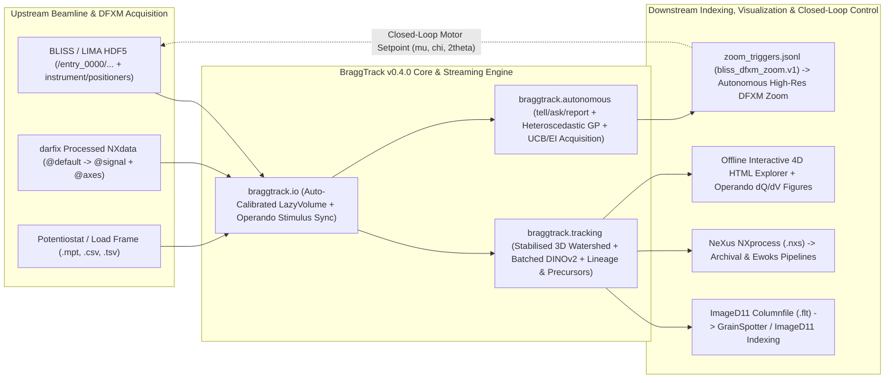
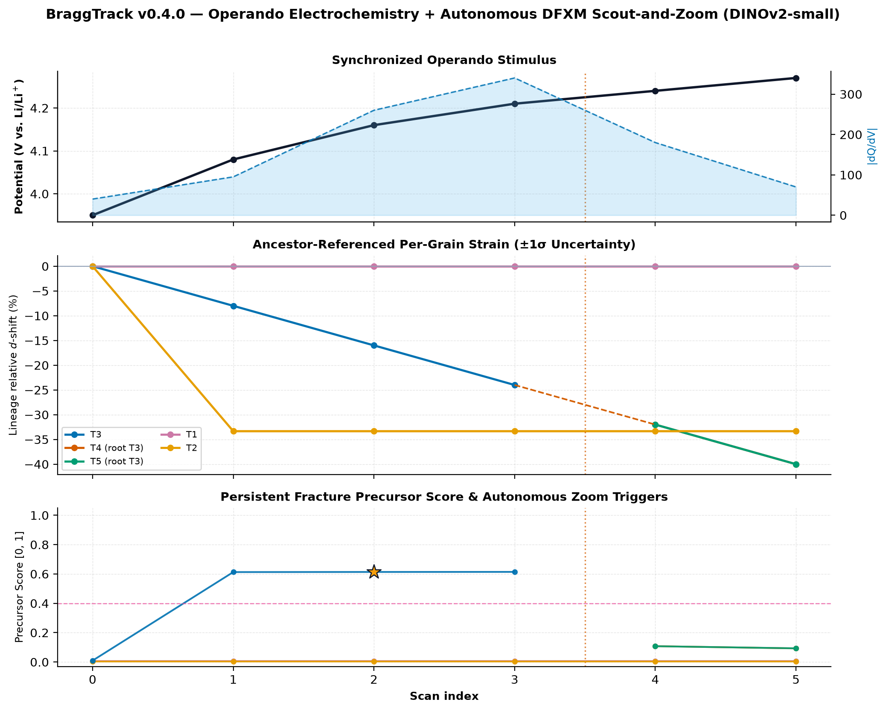

# Ecosystem Positioning & Autonomous Operando DFXM Guide

`BraggTrack` occupies a distinct layer in the synchrotron X-ray diffraction software ecosystem: **object-centric 4D reciprocal-space tracking, chemomechanical fracture lineage (`1 -> 2+` splits & `2+ -> 1` merges), operando electrochemistry synchronization, and GP-guided "Scout-and-Zoom" target selection for autonomous Dark-Field X-ray Microscopy (DFXM)**.

Rather than replacing upstream beamline acquisition engines (`BLISS`/`LIMA`, `Ewoks`, `Bluesky`) or downstream crystallographic unit-cell indexers (`ImageD11`, `HEXRD`, `GrainSpotter`) and DFXM pixel-moment mappers (`darfix`), `BraggTrack` bridges 3D reciprocal-space reflection series and grain-resolved chemomechanical failure dynamics.

---

## 1. Software Ecosystem Comparison Matrix

| Capability / Design Axis | **`BraggTrack` (`v0.4.0`)** | **`darfix`** *(Garriga Ferrer et al., 2023)* | **`ImageD11` / `GrainSpotter`** *(Wright, 2023; Schmidt, 2014)* | **`HEXRD`** *(Bernier et al., 2011)* | **`BraggNN`** *(Liu et al., 2022)* | **`TrackMate 7` / `LapTrack`** *(Ershov et al., 2022; Fukai & Kawaguchi, 2023)* |
| :--- | :--- | :--- | :--- | :--- | :--- | :--- |
| **Primary Scientific Domain** | Operando 4D reciprocal-space & near-field DFXM grain dynamics | Single-reflection real-space DFXM rocking/mosaicity mapping | Polycrystalline 3DXRD peak harvesting & grain orientation indexing | FF-HEDM / nf-HEDM orientation & elastic strain tensor fitting | Fast neural 2D Bragg peak sub-pixel localization | Live-cell bioimage particle & mitosis lineage tracking |
| **Input Representation** | Time-series of 3D $(\mu, \chi, d)$ or $(\omega, y, x)$ NeXus/HDF5 cubes (`LazyVolume`) | 3D/4D real-space DFXM detector stacks (`NXdata` `@signal`/`@axes`) | Thresholded 2D/3D diffraction peak tables (`.flt`) | Raw 2D detector frames + instrument geometry YAML | Small 2D detector patches around candidate peaks | 2D/3D fluorescence microscopy time-lapse stacks |
| **3D Reflection Segmentation** | Stabilised multi-scan chunked Otsu + `float32` 3D LoG + `h`-maxima watershed | Background subtraction, ROI cropping & pixel-wise Gaussian moments | Connected-component / threshold peak search | Omega-wedge peak extraction around virtual grain reflections | Patch-level CNN regression (requires upstream patch cropper) | LoG / DoG / StarDist / Cellpose cell detectors |
| **Foundation Vision Descriptors** | Batched 3-view orthogonal MIP `DINOv2` / `DINOv3` global & patch tokens | PCA / NMF blind source separation on rocking curves | None (scalar centroids & integrated intensities) | None | Supervised CNN latent features (2D patch only) | Hand-crafted cell morphology / CNN embeddings (2D) |
| **Multi-Scan Gap Closing & Lineage** | Jaqaman LAP gap closing + intensity-conserved `1 -> 2+` fracture splits & `2+ -> 1` merges | Per-scan static analysis (no cross-scan grain identity) | Per-scan grain indexing (post-hoc orientation matching required) | Per-scan grain fitting | Frame-by-frame localization only | Mitosis `1 -> 2` division (no Bragg intensity conservation or $d$-strain physics) |
| **Uncertainty & Ancestor Strain** | Analytical Poisson + quantization $\sigma_d, \sigma_\varepsilon$, `assignment_margin`, ancestor `lineage_strain` | Rocking-curve fit residuals | Peak centroid covariance | Least-squares strain tensor covariance | Sub-pixel regression spread | None (spatial pixel coordinates) |
| **Pre-Fracture Precursor Scoring** | Persistent 3D eigenvalue anisotropy, spread growth, 3D sub-peak bimodality & ViT patch dispersion | Per-pixel mosaicity & KAM maps (after high-res zoom) | None | Intragranular peak broadening (post-fit) | None | None |
| **Operando Stimulus Sync** | Native `CSV`/`TSV` & Biologic `.mpt` sync ($E(t), I(t), Q(t)$, regularized $\mathrm{d}Q/\mathrm{d}V$, $\partial\varepsilon/\partial V$) | External user scripting | External user scripting | External user scripting | None | None |
| **Autonomous Beamline Feedback** | `tell / ask / report` causal agent (`braggtrack-watch`) + GP-forecasted `zoom_triggers.jsonl` | Offline / Ewoks batch post-processing of acquired DFXM zoom scans | Offline / batch indexing | Offline / HPC batch fitting | Edge-AI peak streaming (no grain lineage or zoom trigger) | Offline microscopy analysis |

---

## 2. Upstream & Downstream Beamline Interoperability

`BraggTrack` slots cleanly into ESRF ID03 / ID11 and general synchrotron HDF5 workflows without custom file conversion:



### Interoperability Recipes

1. **Zero-Config `darfix` & ESRF BLISS Motor Auto-Calibration (`braggtrack.io.nexus`):**
   - `discover_primary_volume_path()` inspects NeXus `@default` entry and `NXdata` `@signal` attributes before falling back to explicit ESRF-ID03 LIMA paths or largest-3D numeric dataset discovery.
   - `extract_axis_calibration()` automatically extracts physical $(\mu, \chi, d / 2\theta)$ coordinate origins and steps from `NXdata` `@axes` arrays (`darfix` exports) or ESRF BLISS `instrument/positioners/{mu, chi, obpitch, two_theta}` datasets.
2. **Downstream `ImageD11` Polycrystalline Indexing (`--export-imaged11`):**
   - Supplying `--detector-json` maps 3D reflection centroids to transmission crystallographic coordinates $(2\theta, \eta, d, \mathbf{Q})$ and writes standard `ImageD11` `.flt` columnfiles annotated with `track_id` so orientation indexing preserves multi-scan fracture lineage.
3. **Operando Electrochemistry & Potentiostat Coupling (`--operando-log`):**
   - Pass Biologic EC-Lab `.mpt` exports or `.csv`/`.tsv` cycling logs directly to `braggtrack-run` or `braggtrack-report` (`--operando-log cycling.mpt --operando-tz-offset 0.0`). `BraggTrack` interpolates $E(t)$, $I(t)$, $Q(t)$, regularized differential capacity $\mathrm{d}Q/\mathrm{d}V$, and electro-strain susceptibility $\partial\varepsilon/\partial V$ onto every grain observation.

---

## 3. Autonomous "Scout-and-Zoom" Operando DFXM Workflow

High-resolution 4D Dark-Field X-ray Microscopy (`darfix` $(\phi, \chi)$ rocking/mosaicity mapping with an X-ray objective lens) resolves intragranular dislocation walls and strain gradients at ~`50–100 nm` spatial resolution, but has a narrow field of view (single grain, ~`20–80 µm`) and requires minutes per 3D/4D scan. Conversely, wide-field reciprocal-space / near-field scouting monitors `50–200+` grains simultaneously across an electrode, but cannot resolve internal sub-grain microstructure until after catastrophic particle fracture (`1 -> 2+` split) has already occurred.

`BraggTrack v0.4.0` closes this loop via **Scout-and-Zoom**:

1. **Wide-Field Scouting (`CausalStreamingTracker.tell`):**
   - As each wide-field scouting scan finishes writing to disk (`SWMR`-safe with file-quiescence verification), `tracker.tell()` computes a strictly causal trailing-window Otsu threshold (`window = 5` scans, zero lookahead), segments 3D reflections, subtracts local detector pedestals, runs batched `DINOv2` multi-view inference (`embed_batch`), updates bounded $O(1)$ sliding-window trajectories, and evaluates persistent pre-fracture precursors (`anisotropy`, `spread_growth`, `3D sub-peak bimodality`, and `DINOv2 patch dispersion`).
2. **Heteroscedastic GP Trajectory Forecasting & Bayesian Acquisition (`CausalStreamingTracker.ask`):**
   - During rapid electrochemical phase transitions—such as the `H2 -> H3` $c$-axis collapse in **Ni-rich layered oxide cathodes (`LiNi0.92Mn0.04Co0.04O2`, Ni92)** above `4.15 V vs. Li/Li+`—reflections shift rapidly along $d$ ($2\theta$) and rotate in $(\mu, \chi)$ while the diffractometer reconfigures from scouting optics to the DFXM objective lens.
   - `forecast_grain_trajectory_gp()` fits an inverse-variance-weighted linear trend plus a heteroscedastic `Matérn-3/2` Gaussian Process (`scikit-learn`) weighted by analytical Poisson centroid variances $\alpha_i = \sigma_{\text{pos},i}^2$ to forecast smooth $(\mu, \chi, d)$ setpoints across uniform or irregular scan timestamps and size the zoom rocking window from posterior predictive uncertainty.
   - Candidate grains are ranked with standard Bayesian acquisition functions (`ucb`, `ei`, or `max_variance`), with optional closed-loop conditioning on measured high-resolution DFXM outcomes via `tracker.tell_zoom_outcome(track_id, outcome)`.
3. **BLISS / Ewoks JSONL Trigger Stream (`zoom_triggers.jsonl`):**
   - Triggered targets are clamped to diffractometer soft limits and appended to `zoom_triggers.jsonl` using schema `bliss_dfxm_zoom.v1`, ready for consumption by an ESRF BLISS macro, Ewoks workflow, or `Bluesky` plan.



### CLI Usage: Offline Ni92 Replay vs. Live Beamline Directory Watch

**1. Offline Causal Replay & Baseline Policy Evaluation (Before Beamtime):**
Validate trigger precision, pre-fracture lead time, setpoint hit rate, and physical setpoint MAE on archival operando Ni92 datasets against naive policies (`brightest_intensity`, `strain_only`, `random`):

```bash
braggtrack-watch path/to/ni92_scans \
  --mode replay \
  --acquisition ucb \
  --outdir artifacts/ni92_replay \
  --operando-log path/to/ni92_echem.mpt \
  --zoom-budget 5 \
  --cooldown-scans 2 \
  --lead-scans 1.0 \
  --backend torch
```

**2. Live Shadow Mode & Active Beamline Watch (`--mode shadow` -> `--mode active`):**
During live beamtime, validate GP setpoints non-invasively in `--mode shadow` (`"actuate": false`) before switching to `--mode active` with motor, voltage, and X-ray dose guardrails:

```bash
braggtrack-watch /data/visitor/maXXXX/id03/sample_ni92 \
  --mode shadow \
  --acquisition ucb \
  --ucb-beta 1.96 \
  --operando-log /data/visitor/maXXXX/id03/ni92_echem.mpt \
  --mu-bounds -2.5 2.5 \
  --chi-bounds -3.0 3.0 \
  --voltage-bounds 2.8 4.35 \
  --max-zooms-per-lineage 2 \
  --outdir artifacts/live_shadow
```

---

## 4. Relation to Autonomous Beamline & Microscopy Frameworks

`BraggTrack` draws directly on design patterns proven across self-driving synchrotron, neutron, and microscopy facilities rather than inventing bespoke control formalisms:

| Autonomous Framework | Primary Domain | Key Algorithmic Idea Adopted in `BraggTrack` |
| :--- | :--- | :--- |
| **`gpCAM`** *(Noack et al., 2021)* | Synchrotron & neutron scattering (`ALS`, `NSLS-II`, `ILL`) | Heteroscedastic Gaussian Process surrogate modelling (`alpha = sigma_pos**2`) with `UCB`, `EI`, and `max_variance` acquisition |
| **`Bluesky-Adaptive`** *(Maffettone et al., 2023)* | Multimodal user-facility orchestration (`NSLS-II`) | Decoupled `tell()` / `ask()` / `report()` agent protocol separating data ingestion from beamline actuation |
| **`ANDiE`** *(McDannald et al., 2022)* | Autonomous neutron powder/single-crystal diffraction (`ORNL`) | Physics-informed Bayesian active learning prioritizing phase-transition and structural-anomaly regimes |
| **Adaptive XRD** *(Szymanski et al., 2023)* | Autonomous X-ray diffraction phase identification | Uncertainty-driven secondary scans targeted at ambiguous or rapidly evolving Bragg reflections |
| **Autonomous STEM/SPM** *(Kalinin et al., 2021)* | Scanning probe & electron microscopy | Multi-resolution "scout wide, zoom deep" workflows conditioned on local morphological descriptors (`tell_zoom_outcome`) |
| **Facility Autonomy Levels (FAL)** *(Le Houx, 2026; Lu et al., 2025)* | Synchrotron, neutron & muon beamline governance | Operating at conditional, guardrail-bounded autonomy (Level 3) with staged `replay -> shadow -> active` validation |

In the **Facility Autonomy Levels (FAL)** vocabulary (*Le Houx, 2026*), most routine beamline automation operates at **Level 1** (scripted grids) or **Level 2** (reactive signal-space feedback such as centering the brightest peak). `BraggTrack` targets **Level 3** conditional autonomy: decisions act on inferred grain-level crystallographic state (pedestal-debiased reciprocal-space strain, mosaicity anisotropy, rocking-curve kurtosis, and `DINOv2` morphological dispersion) within explicit beamline safety guardrails (`mu/chi/d` soft limits, potentiostat voltage bounds, per-grain X-ray dose caps, and automatic synchrotron beam-dump suppression), progressing safely from offline `replay` to live non-actuating `shadow` mode before `active` closed-loop DFXM zoom.
