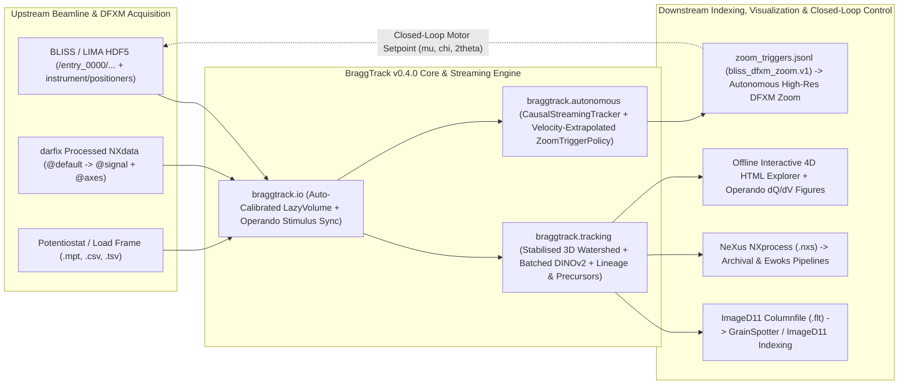

# Ecosystem Positioning & Autonomous Operando DFXM Guide

`BraggTrack` occupies a distinct layer in the synchrotron X-ray diffraction software ecosystem: **object-centric 4D reciprocal-space tracking, chemomechanical fracture lineage (`1 -> 2+` splits & `2+ -> 1` merges), operando electrochemistry synchronization, and online causal "Scout-and-Zoom" target selection for autonomous Dark-Field X-ray Microscopy (DFXM)**.

Rather than replacing upstream beamline acquisition engines (`BLISS`/`LIMA`, `Ewoks`) or downstream crystallographic unit-cell indexers (`ImageD11`, `HEXRD`, `GrainSpotter`) and DFXM pixel-moment mappers (`darfix`), `BraggTrack` bridges 3D reciprocal-space reflection series and grain-resolved chemomechanical failure dynamics.

---

## 1. Software Ecosystem Comparison Matrix

| Capability / Design Axis | **`BraggTrack` (`v0.4.0`)** | **`darfix`** *(Garriga Ferrer et al., 2023)* | **`ImageD11` / `GrainSpotter`** *(Wright, 2023; Schmidt, 2014)* | **`HEXRD`** *(Bernier et al., 2011)* | **`BraggNN`** *(Liu et al., 2022)* | **`TrackMate 7` / `LapTrack`** *(Ershov et al., 2022; Fukai & Kawaguchi, 2023)* |
| :--- | :--- | :--- | :--- | :--- | :--- | :--- |
| **Primary Scientific Domain** | Operando 4D reciprocal-space & near-field DFXM grain dynamics | Single-reflection real-space DFXM rocking/mosaicity mapping | Polycrystalline 3DXRD peak harvesting & grain orientation indexing | FF-HEDM / nf-HEDM orientation & elastic strain tensor fitting | Fast neural 2D Bragg peak sub-pixel localization | Live-cell bioimage particle & mitosis lineage tracking |
| **Input Representation** | Time-series of 3D $(\mu, \chi, d)$ or $(\omega, y, x)$ NeXus/HDF5 cubes (`LazyVolume`) | 3D/4D real-space DFXM detector stacks (`NXdata` `@signal`/`@axes`) | Thresholded 2D/3D diffraction peak tables (`.flt`) | Raw 2D detector frames + instrument geometry YAML | Small 2D detector patches around candidate peaks | 2D/3D fluorescence microscopy time-lapse stacks |
| **3D Reflection Segmentation** | Stabilised multi-scan chunked Otsu + 3D LoG + `h`-maxima watershed | Background subtraction, ROI cropping & pixel-wise Gaussian moments | Connected-component / threshold peak search | Omega-wedge peak extraction around virtual grain reflections | Patch-level CNN regression (requires upstream patch cropper) | LoG / DoG / StarDist / Cellpose cell detectors |
| **Foundation Vision Descriptors** | Batched 3-view orthogonal MIP `DINOv2` / `DINOv3` global & patch tokens | PCA / NMF blind source separation on rocking curves | None (scalar centroids & integrated intensities) | None | Supervised CNN latent features (2D patch only) | Hand-crafted cell morphology / CNN embeddings (2D) |
| **Multi-Scan Gap Closing & Lineage** | Jaqaman LAP gap closing + intensity-conserved `1 -> 2+` fracture splits & `2+ -> 1` merges | Per-scan static analysis (no cross-scan grain identity) | Per-scan grain indexing (post-hoc orientation matching required) | Per-scan grain fitting | Frame-by-frame localization only | Mitosis `1 -> 2` division (no Bragg intensity conservation or $d$-strain physics) |
| **Uncertainty & Ancestor Strain** | Analytical Poisson + quantization $\sigma_d, \sigma_\varepsilon$, `assignment_margin`, ancestor `lineage_strain` | Rocking-curve fit residuals | Peak centroid covariance | Least-squares strain tensor covariance | Sub-pixel regression spread | None (spatial pixel coordinates) |
| **Pre-Fracture Precursor Scoring** | Persistent 3D eigenvalue anisotropy, spread growth, 3D sub-peak bimodality & ViT patch dispersion | Per-pixel mosaicity & KAM maps (after high-res zoom) | None | Intragranular peak broadening (post-fit) | None | None |
| **Operando Stimulus Sync** | Native `CSV`/`TSV` & Biologic `.mpt` sync ($E(t), I(t), Q(t)$, regularized $\mathrm{d}Q/\mathrm{d}V$, $\partial\varepsilon/\partial V$) | External user scripting | External user scripting | External user scripting | None | None |
| **Autonomous Beamline Feedback** | Causal streaming (`braggtrack-watch`) + velocity-extrapolated BLISS `zoom_triggers.jsonl` | Offline / Ewoks batch post-processing of acquired DFXM zoom scans | Offline / batch indexing | Offline / HPC batch fitting | Edge-AI peak streaming (no grain lineage or zoom trigger) | Offline microscopy analysis |

---

## 2. Upstream & Downstream Beamline Interoperability

`BraggTrack` slots cleanly into ESRF ID03 / ID11 and general synchrotron HDF5 workflows without custom file conversion:



### Interoperability Recipes

1. **Zero-Config `darfix` & ESRF BLISS Motor Auto-Calibration (`braggtrack.io.nexus`):**
   - `discover_primary_volume_path()` inspects NeXus `@default` entry and `NXdata` `@signal` attributes before falling back to explicit ESRF-ID03 LIMA paths or largest-3D numeric dataset discovery.
   - `extract_axis_calibration()` automatically extracts physical $(\mu, \chi, d / 2\theta)$ coordinate origins and steps from `NXdata` `@axes` arrays (`darfix` exports) or ESRF BLISS `instrument/positioners/{mu, chi, obpitch, two_theta}` datasets.
2. **Downstream `ImageD11` Polycrystalline Indexing (`--export-imaged11`):**
   - Supplying `--detector-json` maps 3D reflection centroids to transmission crystallographic coordinates $(2\theta, \eta, d, \mathbf{Q})$ and writes standard `ImageD11` `.flt` columnfiles annotated with `track_id` so orientation indexing preserves multi-scan fracture lineage.
3. **Operando Electrochemistry & Potentiostat Coupling (`--operando-log`):**
   - Pass Biologic EC-Lab `.mpt` exports or `.csv`/`.tsv` cycling logs directly to `braggtrack-run` or `braggtrack-report` (`--operando-log cycling.mpt --operando-tz-offset 0.0`). `BraggTrack` interpolates $E(t)$, $I(t)$, $Q(t)$, regularized differential capacity $\mathrm{d}Q/\mathrm{d}V$, and electro-strain susceptibility $\partial\varepsilon/\partial V$ onto every grain observation.

---

## 3. Autonomous "Scout-and-Zoom" Operando DFXM Workflow

High-resolution 4D Dark-Field X-ray Microscopy (`darfix` $(\phi, \chi)$ rocking/mosaicity mapping with an X-ray objective lens) resolves intragranular dislocation walls and strain gradients at ~`50–100 nm` spatial resolution, but has a narrow field of view (single grain, ~`20–80 µm`) and requires minutes per 3D/4D scan. Conversely, wide-field reciprocal-space / near-field scouting monitors `50–200+` grains simultaneously across an electrode, but cannot resolve internal sub-grain microstructure until after catastrophic particle fracture (`1 -> 2+` split) has already occurred.

`BraggTrack v0.4.0` closes this loop via **Scout-and-Zoom**:

1. **Wide-Field Scouting (`CausalStreamingTracker`):**
   - As each wide-field scouting scan finishes writing to disk, `CausalStreamingTracker.step()` computes a strictly causal trailing-window Otsu threshold (`window = 5` scans, zero lookahead), segments 3D reflections, runs batched `DINOv2` multi-view inference (`embed_batch`), updates incremental Hungarian associations and causal gap closures, and evaluates persistent pre-fracture precursors (`anisotropy`, `spread_growth`, `3D sub-peak bimodality`, and `DINOv2 patch dispersion`) using an $O(1)$-volume-RAM ROI cache.
2. **Velocity-Extrapolated Setpoint Prediction (`ZoomTriggerPolicy`):**
   - During rapid electrochemical phase transitions—such as the `H2 -> H3` $c$-axis collapse in **Ni-rich layered oxide cathodes (`LiNi0.92Mn0.04Co0.04O2`, Ni92)** above `4.15 V vs. Li/Li+`—reflections shift rapidly along $d$ ($2\theta$) and rotate in $(\mu, \chi)$ while the diffractometer reconfigures from scouting optics to the DFXM objective lens.
   - Instead of commanding stale centroids from scan $t$, `compute_target_geometry()` extrapolates causal velocities (`rate_mu`, `rate_chi`, `rate_d`) across the reconfiguration lead (`--lead-scans`) and sizes the zoom rocking window from $k_\sigma \sqrt{\mathrm{Var}_{\text{spot}} + (\sigma_{\text{pos}})^2}$:
     $$\hat{\mathbf{x}}(t + \Delta s_{\text{lead}}) = \mathbf{x}(t) + \dot{\mathbf{x}}(t)\,\Delta s_{\text{lead}}$$
3. **BLISS / Ewoks JSONL Trigger Stream (`zoom_triggers.jsonl`):**
   - Triggered targets are appended atomically to `zoom_triggers.jsonl` using schema `bliss_dfxm_zoom.v1`, ready for consumption by an ESRF BLISS macro or Ewoks listener task.


### CLI Usage: Offline Ni92 Replay vs. Live Beamline Directory Watch

**1. Offline Causal Replay & Baseline Policy Evaluation (Before Beamtime):**
Validate trigger precision, **Lead-Time Before Fracture** ($\Delta s_{\text{lead}} = s_{\text{split}} - s_{\text{trigger}}$), and setpoint hit rate on archival operando Ni92 datasets against naive policies (`brightest_intensity`, `strain_only`, `random`):

```bash
braggtrack-watch path/to/ni92_scans \
  --mode replay \
  --outdir artifacts/ni92_replay \
  --operando-log path/to/ni92_echem.mpt \
  --zoom-budget 5 \
  --cooldown-scans 2 \
  --lead-scans 1.0 \
  --backend torch
```

**2. FAL Shadow Mode & Certified Active Beamline Watch (`--mode shadow` $\to$ `--mode active`):**
During live beamtime, validate setpoints and Sim-to-Real Gap ($\Delta_{\text{gap}}$) calibration non-invasively in `--mode shadow` (`"actuate": false`) before switching to `--mode active` inside an explicit Operational Design Domain:

```bash
braggtrack-watch /data/visitor/maXXXX/id03/sample_ni92 \
  --mode shadow \
  --hypothesis mechanical_fracture \
  --operando-log /data/visitor/maXXXX/id03/ni92_echem.mpt \
  --mu-bounds -2.5 2.5 \
  --chi-bounds -3.0 3.0 \
  --voltage-bounds 2.8 4.35 \
  --max-zooms-per-lineage 2 \
  --scan-cadence-sec 30.0 \
  --outdir artifacts/live_shadow
```

---

## 4. Facility Autonomy Levels (FAL) Classification & Operational Design Domain

Following the **Facility Autonomy Levels (FAL)** taxonomy for self-driving synchrotron and neutron beamlines (*Le Houx, 2026*) and the **Heuristic Operando** framework (*Lu et al., 2025*, `arXiv:2601.00851`), `BraggTrack v0.4.0` is engineered specifically to operate at **FAL Level 3 (Conditional Heuristic Autonomy)** within a bounded **Operational Design Domain ($\mathcal{O}_{\text{ODD}}$)**, maximizing Entropy-Scaled Measurement Efficiency ($E_{\text{SME}}$) without crossing premature uncertified liability boundaries:

| FAL Level | Agency Regime | Synchrotron Diffraction / DFXM Example | `BraggTrack` Role |
| :--- | :--- | :--- | :--- |
| **L0 — Manual** | Human selects every $(x, y, \mu, \chi, 2\theta)$ scan | Manual single-grain alignment in `BLISS` | Offline inspection (`braggtrack-inspect`) |
| **L1 — Scripted** | Pre-programmed uniform grid / time-loop | Fixed-cadence wide-field scouting loop | Batch post-processing (`braggtrack-run`) |
| **L2 — Reactive Feedback** | Signal-space feedback (no physical prior or hypothesis dependence) | Centering brightest peak or threshold intensity trigger | Baseline comparators (`brightest_intensity`) + latency fallback (`L2_fallback`) |
| **$\uparrow$ *Inference Barrier*** | *Requires physical sample state + external reference prior + hypothesis-conditioned policy* | | |
| **L3 — Conditional Heuristic** | Hypothesis-driven multi-scale steering inside human-defined $\mathcal{O}_{\text{ODD}}$ | **Autonomous wide-field $\to$ high-res DFXM Scout-and-Zoom** | **`braggtrack.autonomous` (`CausalStreamingTracker`, `OperationalDesignDomain`)** |
| **$\uparrow$ *Liability Threshold*** | *Requires prior certification of agent for unsupervised multi-hazard hardware control* | | |
| **L4 — Certified Domain Autonomy** | Self-certified multi-modality orchestration across full beamtime block | Autonomous potentiostat + diffractometer co-steering | Future Ewoks/BLISS certified safety interlock integration |

### How `BraggTrack` Satisfies the Three FAL Level 3 Conditions

1. **Condition (i) — Decisions Act on Inferred Physical Sample State:**
   - Rather than triggering on raw detector ADUs, `BraggTrack` subtracts local detector background pedestals, transforms centroids and covariances into calibrated reciprocal-space $(\mu, \chi, d)$ coordinates, disambiguates crystallographic orientation cleavage (`mechanical_split`) from first-order two-phase jumps (`phase_split`, e.g., Ni92 `H2 -> H3`), and computes scale-invariant **standardized Pearson excess kurtosis** along each rocking axis (*Le Houx et al., 2026*):
     $$g_{2,k} = \frac{\mu_{4,k}}{\mu_{2,k}^2} - 3, \quad k \in \{\mu, \chi, d\}$$
     capturing localized surface-flaw dislocation pileups ($g_2 > 0$) and incipient sub-grain splitting ($g_2 < 0$) before macroscopic fracture.
2. **Condition (ii) — Interpretation Against External / Calibrated Reference Priors:**
   - Combines an external pretrained vision-transformer prior (`facebook/dinov2-small` multi-view global and foreground patch-token dispersion) with `BulkReferencePrior`, which robustly estimates $(\mu_{\text{bulk}}, \sigma_{\text{bulk}})$ via median and MAD across the initial undeformed grain ensemble to set dynamic kurtosis anomaly thresholds $K_{\text{thresh}} = \mu_{\text{bulk}} + 3\sigma_{\text{bulk}}$.
3. **Condition (iii) — Explicit Dependence on Declared Scientific Hypothesis ($H$):**
   - Setting `--hypothesis {mechanical_fracture, phase_nucleation, intragranular_disorder}` redirects the beamline to physically distinct grain populations on the exact same operando stream (persistent bimodal sub-peak cleavage vs. high-$|\dot{\varepsilon}|$ redox phase fronts vs. heavy-tailed $g_2 \ge K_{\text{thresh}}$ intragranular defect nucleation).

### Operational Design Domain ($\mathcal{O}_{\text{ODD}}$), Staged Certification & Sim-to-Real Gap ($\Delta_{\text{gap}}$)

- **Latency Criterion & $O(1)$ Sliding-Window Streaming:** `CausalStreamingTracker` freezes historical track anchors outside a bounded `sliding_window_scans` horizon so per-scan runtime $\tau_{\text{loop}}$ stays $O(1)$ across `1,000+` scans and is continuously verified against $\tau_{\text{loop}} \le t_{\text{decision}} / \kappa$ (`OperationalDesignDomain.evaluate_latency_budget`).
- **Discovery Potential & Beam-Dump Suppression:** Candidate heuristic scores $H(x)$ are weighted by upstream synchrotron flux health $\mathcal{W}(\mathbf{s}_t) \in [0, 1]$, $D(x) = H(x)\cdot\mathcal{W}(\mathbf{s}_t)$, halting actuation (`L1_halt`) during beam dumps, shutter closures, or electrochemical voltage/temperature ODD excursions, while enforcing motor soft-limits and per-lineage X-ray dose caps (`--max-zooms-per-lineage`).
- **Closed-Form Sim-to-Real Audit (`audit_trajectory.jsonl`):** Every zoom prediction $\mathcal{N}(\hat{\boldsymbol{\mu}}_{t+1}, \mathrm{diag}(\boldsymbol{\sigma}_{\text{pred}}^2))$ is automatically audited when scan $t + 1$ arrives using the unit-invariant differential-entropy-normalized Gaussian surprise:
  $$\Delta_{\text{gap}} = -\ln P_{\text{sim}}(\mathbf{s}'_{\text{obs}} \mid \mathbf{s}_t, \mathbf{a}_t) - H\!\left[P_{\text{sim}}(\cdot \mid \mathbf{s}_t, \mathbf{a}_t)\right] = \frac{1}{2}\sum_{k \in \{\mu, \chi, d\}} \frac{(s'_{\text{obs},k} - \hat{\mu}_k)^2}{\sigma_{\text{pred},k}^2} - \frac{3}{2}$$
  Under nominal calibration, $\mathbb{E}[\Delta_{\text{gap}}] = 0$ and $2\Delta_{\text{gap}} + 3 \sim \chi^2_3$ ($\epsilon_{\text{valid},0.99} \approx 4.172$), providing quantitative sign-off from `--mode replay` $\to$ `--mode shadow` $\to$ `--mode active`.

