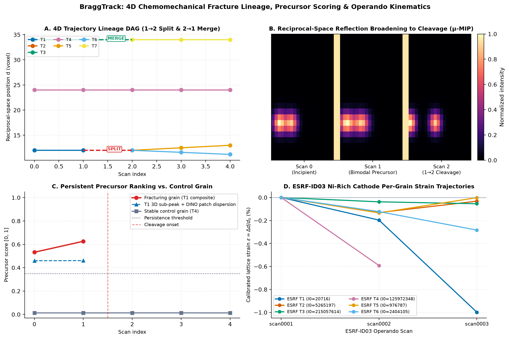

# Summary

BraggTrack is a Python library for automated 3D reflection segmentation,
crystallographic trajectory tracking, kinematic strain extraction, and
chemomechanical fracture lineage analysis across sequential operando X-ray
diffraction (XRD) volumes. Given a time series of three-dimensional
reciprocal-space or near-field diffraction cubes acquired during *in situ* or
*operando* experiments, BraggTrack segments individual Bragg reflections above
detector read-noise pedestals, extracts calibrated 3D geometric moments (with
optional foundation vision descriptors), and links observations across scans
into a directed acyclic trajectory graph capturing births, continuations,
terminations, `1 -> 2+` grain fracture splits, `2+ -> 1` coalescence merges,
reversible crowding overlaps, and multi-scan gap closures across transient beam
dropouts. In addition, BraggTrack ranks persistent pre-fracture precursor
candidates across scans by combining baseline-referenced 3D reflection
anisotropy, covariance broadening, skewness/kurtosis shifts, internal sub-peak
bimodality, and optional frozen vision-transformer patch-token dispersion.
Designed for synchrotron NeXus/HDF5 data, BraggTrack supports zero-configuration
`darfix` and ESRF BLISS motor auto-calibration, lazy HDF5 ROI streaming,
collective rocking-slab drift registration, analytical Poisson centroid/strain
uncertainties, operando electrochemistry synchronization (`--operando-log`),
crystallographic $(2\theta, \eta, d, |\mathbf{Q}|)$ conversion with direct
`ImageD11` (`.flt`) and NeXus `NXprocess` HDF5 export, publication plotting and
offline interactive HTML 4D lineage reports (`braggtrack-report`), causal
online streaming with time- or electrochemical state-space Gaussian process
Dark-Field X-ray Microscopy (DFXM) zoom triggering (`braggtrack-watch`),
`O(1)`-memory multi-hundred-scan archive evaluation (`braggtrack-eval-archive`),
bundled operando scans from ESRF beamline ID03, eleven CLI entry points, and
interactive Jupyter notebooks runnable on Google Colab.

# Statement of Need

Operando diffraction experiments at modern synchrotron sources generate
hundreds to thousands of three-dimensional diffraction volumes at sub-minute or
sub-second cadence, each containing tens to hundreds of Bragg reflections whose
positions, intensities, and 3D morphologies evolve during electrochemical
cycling, mechanical loading, or thermal treatment [@Simons2015; @Hayashi2019; @Isern2025].
Yet brute-force grid automation faces a recognized crisis in reliability,
representativeness, and reproducibility [@Drnec2025], expending the majority of
incident flux on bulk elastic volume while missing spatially localized transient
failure events [@Lu2025]. In battery electrodes such as Ni-rich layered oxides,
chemomechanical degradation initiates deterministically at surface stress
concentrators as localized dislocation pileups, non-Gaussian rocking-curve tails,
and anisotropic sub-domain formation before culminating in particle microcracking
— observable in reciprocal space as reflection broadening followed by `1 -> 2+`
peak splitting [@Finegan2017; @LeHoux2026]. Quantifying per-grain lattice strain
($\varepsilon = \Delta d / d_0$), lattice rotation ($\Delta\mu$, $\Delta\chi$),
standardized rocking-curve excess kurtosis ($g_2$), and fracture lineage across
crowded polycrystalline scan sequences — and steering high-resolution DFXM zoom
onto pre-fracture grains online to maximize Entropy-Scaled Measurement Efficiency
($E_{\text{SME}}$) [@Lu2025] — is essential for linking local crystallography to
macroscopic failure, as well as for solidification and additive manufacturing
studies [@Leung2018].

Existing diffraction, autonomous steering, and tracking packages address
complementary parts of this workflow: crystallographic indexing suites such as
GrainSpotter [@Schmidt2014], 3DXRD orientation mappers [@Poulsen2004], HEXRD
[@Bernier2011], and ImageD11 [@Wright2023] determine unit-cell orientations and
static grain tensors; deep neural localizers such as BraggNN [@Liu2022]
accelerate 2D sub-pixel peak finding; DFXM analysis suites such as *darfix*
[@GarrigaFerrer2023] map pixel-wise rocking-curve moments once a single-grain
zoom scan has been acquired; adaptive powder/single-crystal steering frameworks
[@McDannald2022; @Szymanski2023] optimize scalar phase or magnetic peak
acquisition without 4D multi-grain fracture lineage; and bioimage
linear-assignment trackers such as TrackMate 7 [@Ershov2022] and LapTrack
[@Fukai2023] link cell trajectories without reciprocal-space Bragg strain
physics, collective rocking-layer drift compensation, integrated-intensity split
conservation, or synchrotron beamline metadata. Previously, researchers lacked
an open-source, `pip`-installable toolkit combining pedestal-safe 3D spot
segmentation, orientation-sensitive 3D optimal-transport and optional ViT
descriptors, calibrated per-grain kinematics with analytical uncertainties,
explicit mechanical vs. two-phase vs. reversible-overlap split/merge lineage,
operando potentiostat synchronization, and Facility Autonomy Level 3 (FAL L3)
[@LeHouxFAL2026] causal DFXM target selection.

BraggTrack addresses this need by separating beamline HDF5 ingestion and axis
calibration, operando stimulus synchronization, 3D instance segmentation,
classical 3D reciprocal-space and optional multi-view vision-transformer
encoding, collective drift-compensated Hungarian/Jaqaman lineage tracking,
fracture precursor scoring, FAL L3 causal streaming (`braggtrack.autonomous`),
and interactive visualization (`braggtrack.viz`) into cleanly tested, modular
layers.

# Implementation

## Beamline ingestion, lazy HDF5 streaming, operando sync, and crystallographic mapping

BraggTrack discovers sequential `scan*` directories, inspects NeXus/HDF5 trees
(including `NXdata` `@default`/`@signal` hierarchies exported by *darfix*
[@GarrigaFerrer2023], ESRF-ID03 LIMA detector hierarchies under `/entry_0000/...`
[@Isern2025], and generic HDF5 layouts via automatic largest-3D numeric dataset
discovery with Single-Writer Multiple-Reader `SWMR` support), and validates
timestamp monotonicity. To handle gigabyte-scale detector stacks without
exhausting host memory, `LazyVolume` streams `z`-slabs for exact two-pass
pedestal-guarded Otsu histogramming (`detector_foreground_threshold_chunked`)
and reads only tight 3D spot or rocking-patch sub-blocks (`read_roi`) during
drift registration, optional ViT embedding, and precursor analysis.

An `AxisCalibration` transform — supplied via JSON or auto-extracted from
NeXus `@axes` arrays and ESRF BLISS `instrument/positioners` metadata — converts
raw detector indices into physical reciprocal-space coordinates $(\mu, \chi, d)$
while preserving integer voxel bounding boxes for lossless 3D ROI cropping. When
operando electrochemistry logs (`.csv`, `.tsv`, or Biologic EC-Lab `.mpt`) are
provided via `--operando-log`, `braggtrack.io.operando_log` synchronizes cell
potential $E(t)$, current $I(t)$, specific capacity $Q(t)$, regularized
differential capacity $\mathrm{d}Q/\mathrm{d}V$, and per-grain electro-strain
susceptibility $\partial\varepsilon/\partial V$ onto scan timestamps.
Complementarily, `DetectorGeometry` maps transmission-diffraction spot centroids
into crystallographic scattering angle $2\theta$, azimuth $\eta$, $d$-spacing
($\lambda = 2 d \sin\theta$), and reciprocal-lattice vectors $\mathbf{Q}$
($\text{\AA}^{-1}$), exporting directly to `ImageD11` columnfiles (`.flt`)
[@Wright2023] and self-describing NeXus `NXprocess` HDF5 archives (`.nxs`).

## Pedestal-safe 3D segmentation

BraggTrack's primary segmentation pipeline processes 3D volumes in `float32`
across four stages:

1. **Read-noise-guarded foreground thresholding.** On sparse sCMOS diffraction
   frames (e.g., ESRF-ID03 `pco_nf` with a `~180 ADU` electronic dark pedestal),
   unconstrained global Otsu thresholding [@Otsu1979] splits the Gaussian
   read-noise peak itself. `detector_foreground_threshold` enforces a robust
   `median + k · MAD` read-noise floor (`1.4826 · MAD`, default $k = 5\sigma$)
   and computes Otsu strictly on tail intensities above that floor, followed by
   cross-scan rolling-median smoothing (`smooth_thresholds`) to suppress
   transient beam-flux jitter.

2. **3D LoG enhancement.** Gaussian smoothing followed by the negative discrete
   Laplacian highlights Bragg reflections as local maxima [@Lindeberg1998]
   independently of intensity-domain foreground masking.

3. **Robust seed detection.** `h`-maxima filtering [@Soille2003] selects seeds
   exceeding both a fraction of the 99.99th-percentile foreground response and a
   high response percentile with non-maximum suppression.

4. **Seeded watershed, pedestal subtraction, and full 3D moments.**
   Watershed region growing [@Vincent1991] over the inverted LoG response is
   followed by small-object removal, 3D hole filling, nearby-basin merging,
   local exterior background pedestal subtraction, gain-aware analytical Poisson
   plus voxel-quantization centroid standard errors, full $3 \times 3$ intensity-weighted
   covariance tensors and eigenvalues, standardized Pearson rocking-curve
   skewness and excess kurtosis ($g_2 = \mu_4 / \mu_2^2 - 3$), and rocking-scan
   boundary truncation flags (`touches_rocking_border`). An experimental batched
   dense patch-feature + HDBSCAN slice-stitching segmenter (`segment_dino`) is
   also provided for cross-method comparison.

## Classical optimal-transport morphology and optional ViT descriptors

By default (`--cost-beta 0.0`), BraggTrack operates purely classically without
GPU or neural-network overhead, offering either step-normalized centroid plus
log-eigenvalue width matching (`PositionShapeCost`) or a closed-form 3D Gaussian
2-Wasserstein / Bures optimal-transport cost (`WassersteinBuresCost`,
`--cost-model wasserstein_bures`) [@Bhatia2019] coupled with scale-free
log-intensity conservation:
$$W_2^2(i, j) = \|\mathbf{m}_i - \mathbf{m}_j\|_2^2 + b_w\,\mathrm{Tr}\!\left(\mathbf{\Sigma}_i + \mathbf{\Sigma}_j - 2(\mathbf{\Sigma}_i^{1/2}\mathbf{\Sigma}_j\mathbf{\Sigma}_i^{1/2})^{1/2}\right) + w_I\left(\ln\frac{I_i^{\mathrm{net}}}{I_j^{\mathrm{net}}}\right)^2.$$
Because the Bures matrix term preserves full 3D eigenvector orientation in native
$\text{step}^2$ units, it resolves crossing tilted streaks (`+45°` vs. `-45°`)
whose scalar eigenvalues $(\lambda_1, \lambda_2, \lambda_3)$ are identical.

When visual transformer features are explicitly requested (`--cost-beta > 0`),
each segmented 3D reflection is cropped via `LazyVolume`, masked to its instance
support, and projected into three orthogonal maximum-intensity projections
(MIPs) along $\mu$, $\chi$, and $d$ with aspect-ratio-preserving letterbox
padding. BraggTrack batches all $3 N_{\text{spots}}$ views per scan through the
public, ungated DINOv2 vision transformer (`facebook/dinov2-small`) [@Oquab2024]
into an $L_2$-normalised 1152-d descriptor (`embed_batch`), while also supporting
DINOv3 backbones (`facebook/dinov3-vitb16-pretrain-lvd1689m`) and a deterministic
hash-based `mock` encoder for offline continuous integration.

## Collective drift registration, tracking, kinematics, and fracture lineage

In dense polycrystalline electrodes, rigid sample translation or collective
Debye–Scherrer ring shifts (`12–25 px/scan`) frequently exceed inter-reflection
spacing (`12–20 px`) within a rocking layer, causing nearest-neighbor assignment
aliasing. Before frame-to-frame assignment, BraggTrack provides optional
collective drift registration (`--drift-mode`): windowed 2D sub-pixel FFT phase
cross-correlation (`estimate_slab_shifts_fft`) [@GuizarSicairos2008] over
pedestal-subtracted rocking-slab MIPs, spot-table Parzen mode consensus
(`estimate_band_shifts_consensus`), and a decoupled 6D constant-velocity Kalman
filter (`TrackKalmanState`) [@Kalman1960] propagating analytical Poisson centroid
variances across frames.

Frame-to-frame association solves the Jaqaman birth/death linear assignment
problem [@Kuhn1955; @Jaqaman2008] over $\alpha \cdot C_{\text{geo}}(i, j) +
\beta \cdot (1 - \cos(\mathbf{f}_i, \mathbf{f}_j))$ — guaranteeing trajectory
invariance under arbitrary physical `AxisCalibration` scales and rejecting
single-slice cosmic-ray specks — while recording runner-up `assignment_margin`
values in a NetworkX [@Hagberg2008] `DiGraph`. Prior to topological event
detection, `resolve_track_gaps` bridges transient beam dropouts (`--max-gap`) via
diffusive displacement scaling ($\Delta r^2 / \Delta t$). From each trajectory,
`compute_grain_kinematics` extracts local strain $\Delta d / d_0$,
ancestor-referenced `lineage_strain` across splits, propagated $\sigma_\varepsilon$,
causal angular and lattice velocities (`rate_mu`, `rate_chi`, `rate_d`,
`strain_rate`, `strain_rate_per_s`), integrated intensity evolution, and 3D
eigenvalue anisotropy.

To capture grain fracture, coalescence, and transient crowding,
`resolve_splits_and_merges` links unmatched birth and termination nodes into
`1 -> 2+` split and `2+ -> 1` merge edges gated by proximity, log-intensity
volume conservation ($|\ln(I_{\text{children}} / I_{\text{parent}})|$), and
minimum fragment share, classifying events into crystallographic orientation
cleavage (`mechanical_split`), first-order two-phase lattice jumps
(`phase_split`, e.g., `H2 -> H3` coexistence), `mixed_split`, or transient
watershed coalescence (`reversible_overlap` when fragments re-separate within a
short scan horizon) (\autoref{fig:lineage}). Complementarily,
`compute_fracture_precursors` scores persistent intragranular degradation using
3D eigenvalue anisotropy, covariance trace growth, internal 3D sub-peak
bimodality, optional baseline-referenced intra-grain morphology deltas
(`--precursor-baseline-reference`), and optional foreground ViT patch-token
dispersion, accompanied by ROC-AUC and PR-AUC channel evaluation
(`evaluate_precursor_channels_roc`).

## Causal streaming, state-space Gaussian processes, and autonomous DFXM targeting

Building on Gaussian process and Bayesian active-learning architectures across
synchrotron, neutron, and microscopy facilities [@Noack2021; @McDannald2022;
@Kalinin2021; @Szymanski2023], `braggtrack.autonomous` (`CausalStreamingTracker`
and `braggtrack-watch`) implements the decoupled `tell` / `ask` / `report`
interface standardized by `Bluesky-Adaptive` [@Maffettone2023]. Bounded $O(1)$
sliding-window DAG updates (`tell`) maintain sub-second per-scan latency across
`1,000+` scan operando campaigns without future lookahead. For diffractometer
setpoint prediction during rapid phase transitions (`H2 -> H3`),
`forecast_grain_trajectory_gp` fits an inverse-variance-weighted linear trend
plus a heteroscedastic `Matérn-3/2` Gaussian process weighted by analytical
Poisson centroid variances ($\alpha_i = \sigma_{\text{pos},i}^2$) in either
wall-clock time (`--forecast-domain time`) or causal electrochemical state space
$(Q(t), V(t))$ (`--forecast-domain state_space` when `--operando-log` is
provided), alongside persistence, two-point constant-velocity, and Kalman CV
baselines. Candidate grains are ranked (`ask`) via Upper Confidence Bound (`ucb`),
Expected Improvement (`ei`), or pure variance exploration (`max_variance`), with
optional closed-loop conditioning on high-resolution DFXM zoom outcomes
(`tell_zoom_outcome`). Within the Facility Autonomy Levels taxonomy
[@LeHouxFAL2026; @Lu2025], `braggtrack-watch` supports `replay`, live
non-actuating `shadow`, and `active` closed-loop operation under diffractometer
soft limits, electrochemical voltage bounds, per-grain X-ray dose caps, and
beam-dump suppression, emitting `bliss_dfxm_zoom.v1` JSONL commands
(`zoom_triggers.jsonl`).

## Quantitative evaluation, visualization, and reproducibility

Across controlled 4D synthetic benchmarks (`scripts/benchmark_suite.py`;
\autoref{fig:benchmarks}), both closed-form 3D `WassersteinBuresCost` and
opt-in multi-view `facebook/dinov2-small` descriptors eliminate crossing ID
switches between reflections with identical scalar 3D eigenvalues (`+45` vs.
`-45` deg detector tilts), while Jaqaman gap closing (`--max-gap 2`) recovers
100% of staggered beam dropouts. On the bundled real ESRF-ID03 `pco_nf` sCMOS
scans (`data/sample_operando/`, $n = 3$ scans), read-noise-guarded Otsu
thresholding eliminates `46.4%` dark-pedestal false foreground (`0` false
foreground pixels on empty detector frames), classical tracking matches DINOv2
edge-for-edge at $5.6\times$ lower CPU latency, and collective slab FFT + Kalman
registration resolves crowded-layer co-moving reflection shifts; multi-horizon
GP forecasting and real cleavage precursor ROC-AUC/PR-AUC require longer
multi-scan operando cycling archives (`braggtrack-eval-archive`), supported by a
zero-hint HTML blind human ground-truth annotator (`scripts/build_blind_annotator.py`,
`scripts/evaluate_tracking_gt.py`).

BraggTrack (`pip install braggtrack`) provides eleven CLI commands, including
`braggtrack-report` (generating publication figures, 3-panel operando
electrochemistry $\mathrm{d}Q/\mathrm{d}V$ dashboards, and a zero-CDN offline
interactive HTML 4D Lineage & Strain Explorer), `braggtrack-watch` (live causal
streaming and offline autonomous DFXM replay), `braggtrack-eval-archive`
(`O(1)`-RAM `1,000+`-scan tracking, forecasting, and precursor evaluation), and
`braggtrack-run`, which executes validation, segmentation, optional embedding,
tracking, kinematics, event detection, reporting, and `ImageD11`/NeXus export
while writing a `run_manifest.json` with SHA-256 input checksums and per-stage
runtimes. Automated CI tests Python 3.10–3.12, enforces Ruff linting/formatting,
runs nine acceptance gates (`scripts/ci_report.py`), and executes the tutorial
notebook end-to-end on bundled ESRF-ID03 data.

# Acknowledgements

The authors acknowledge the European Synchrotron Radiation Facility (ESRF)
for provision of beamtime at beamline ID03. This work was supported by the
BASE Laboratory at the University of Greenwich.

# References
